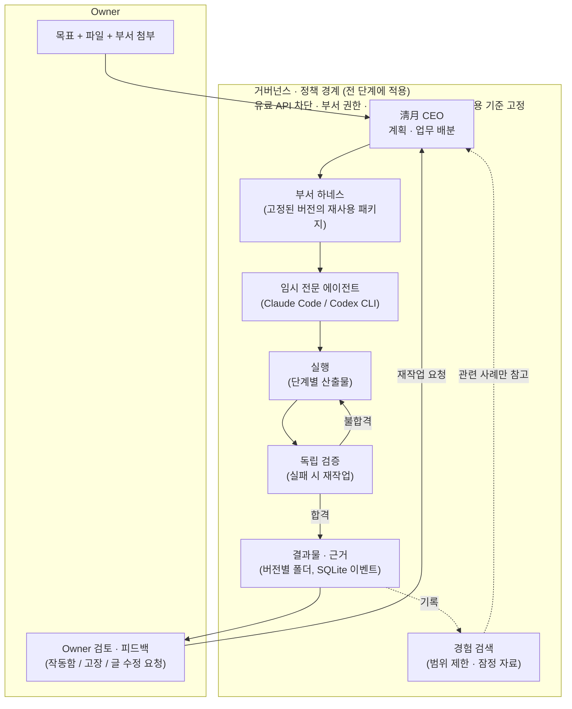
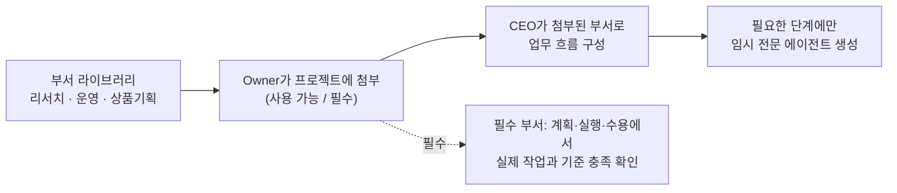
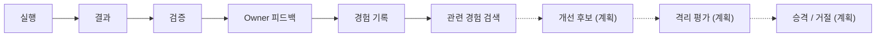

# AX Branch

**Goal-driven autonomous organizational execution under human governance.**

AX Branch is a local workspace where an Owner hands over a goal and AX Branch's AI CEO, **淸月 (Cheongwol)**, does the rest. The CEO plans the work, splits it across the departments the Owner attached, and runs temporary specialist agents on the Owner's Claude Code / Codex CLI subscriptions. Each result is checked by a separate verification step and reworked until it passes. Only then does it reach the Owner for review. The Owner sets the goal and the limits; AX Branch handles the AI work inside them.

> 상태: 개발 중인 개인 프로젝트입니다. 현재 소스는 **0.1.63 후보**이고, Owner가 실제로 쓰는 서버는 이전 빌드 **0.1.61-67d9095**입니다. 두 버전은 같지 않습니다(아래 [버전](#버전-현재-소스와-사용-중인-빌드)).


## 무엇을 해결하나

AI 도구로 일을 맡기면 결국 사람이 계획을 쪼개고, 도구를 고르고, 결과를 검사하고, 다시 시키는 일을 반복하게 됩니다. AX Branch는 이 관리 업무를 대신합니다. Owner는 목표와 자료를 주고, 결과가 실제로 쓸 만한지만 판단합니다.

**구체적인 흐름 예시**

1. Owner가 웹 화면에 목표를 적습니다. 예: "첨부한 문의 기록으로 팀별 문의 건수 보고서를 만들어 줘". CSV를 첨부하고, 부서 라이브러리에서 **리서치**와 **운영**을 끌어다 붙입니다.
2. 淸月 CEO가 계획을 세웁니다. 리서치 단계는 수치와 근거를 정리하고, 운영 단계는 권고안을 만듭니다. 단계마다 그 부서의 역할·도구·권한·수용 기준을 가진 임시 에이전트를 만듭니다.
3. 결과물은 별도의 검증 단계를 거칩니다. 부서 수용 기준(예: "모든 수치에 출처가 있다")을 하나라도 못 지키면 재작업으로 돌아갑니다.
4. 통과한 결과만 Owner 검토에 올라옵니다. Owner가 "제목을 바꿔 줘"처럼 글로 요청하면 **같은 프로젝트**에서 재작업·재검증을 거쳐 고친 버전이 다시 올라옵니다.
5. 기록된 실행·검증 결과는 다음 업무에서 범위를 제한해 참고 자료로 다시 쓰입니다. 이것은 "경험의 재사용"이지 학습이 아닙니다.

## 구조

### 전체 흐름

거버넌스·정책은 마지막 단계가 아니라 계획부터 결과 전달까지 전 과정을 둘러싼 **권한 경계**입니다.



### 부서 구성



### 경험의 수명 주기

실선은 구현된 단계, 점선은 계획된 단계입니다.



### 용어 구분

| 구분 | 의미 |
|---|---|
| **하네스 ≠ 에이전트** | 부서 하네스(`departments/<id>/department.json`)는 역할·도구·권한·입출력·수용 기준을 담은 **재사용 패키지**입니다. 에이전트는 한 단계를 위해 하네스로 만들어졌다가 사라지는 **임시 실행자**입니다. |
| **능력 ≠ 권한** | 에이전트가 할 수 있는 일과 해도 되는 일은 다릅니다. 부서가 네트워크 권한을 선언하지 않으면 웹 조사 단계는 계획 단계에서 거절됩니다. 에이전트에게 셸 권한은 주어지지 않습니다. |
| **경험 저장 ≠ 학습** | 경험은 기존 SQLite 이벤트 저장소에 기록되고 다음 업무에서 참고 자료로 검색될 뿐입니다. 모델 가중치는 바뀌지 않습니다(파인튜닝 없음). |
| **검색된 경험 ≠ 검증된 개선** | 검색된 경험에는 "잠정(PROVISIONAL)" 표시가 붙습니다. 경험이 결과를 실제로 좋게 하는지는 아직 측정되지 않았습니다(아래 한계 참고). |

### 부서

현재 있는 부서는 **리서치**(1.1.0), **운영**(1.1.0), **상품기획**(1.0.1) 세 개입니다. 프로젝트에 붙일 때 그 버전으로 고정되므로 나중에 부서 정의가 바뀌어도 진행 중인 프로젝트에는 몰래 반영되지 않습니다. 각 부서에는 레지스트리 상태(후보·검증됨·격리됨·폐기됨)가 있습니다. 격리·폐기된 부서는 새로 연결하거나 일을 맡길 수 없지만, 이미 고정된 기록은 그대로 남습니다. 현재 세 부서는 상태 도입 전 부서(legacy)로 표시되며, 명세 형식만 검증되었고 행동 검증은 판정되지 않았습니다. 재무·법무·마케팅 같은 부서는 같은 형식으로 추가할 수 있는 **향후 예시**이며, 지금은 없습니다.

## 구현 현황

| 기능 | 상태 | 확인 수준 |
|---|---|---|
| 목표·파일·부서 첨부 → CEO 계획 → 단계 실행 | 구현 | 자동 테스트 · 실제 모델 실행 |
| 부서 하네스 3종, 버전 고정, 계획 시 권한 검사 | 구현 | 자동 테스트 · 실제 모델 실행 |
| 독립 검증과 재작업 루프 (수용 기준은 낮추지 않음) | 구현 | 자동 테스트 · 실제 모델 실행 |
| Owner 글 수정 요청 → 같은 프로젝트에서 재작업·재검증 | 구현 | 실제 패키지 웹 E2E 11/11 (후보 빌드 0.1.63-18fbd6d, P-20261027-f8b412) |
| 검증 출처 기록 (다른 엔진 검증 / 같은 엔진·역할 분리 / 불명) | 구현 | 자동 테스트 |
| 범위를 제한한 경험 검색 (잠정 표시) | 구현 | 자동 테스트 |
| 결과물 라이브러리, 완성된 결과물을 이어서 개발 | 구현 | 자동 테스트 |
| 로컬 웹 화면 · Tk 창 · CLI (같은 동작 공유) | 구현 | 자동 테스트 · 헤드리스 브라우저 |
| Owner 개발실 (AX Branch 자체의 개발 현황) | 구현 | 자동 테스트 |
| 경험 활용 효과 비교 (상품기획 A/B) | **결과 없음** | 2회 시도 모두 과제 A에서 정지 (재시도 없음) |
| H1: 부서 레지스트리 상태(후보·검증·격리·폐기), 근거·기록, 격리 강제 | 구현 | 자동 테스트 (실제 모델 실행 없음) |
| H2: 부서 "사용 가능 / 필수" 구분과 강제 (계획·실행·수용·분리) | 구현 | 자동 테스트 · 헤드리스 브라우저 · 실제 모델 1회 (충족 경로만, [근거](docs/evidence/2026-10-26-h2-required-real-run.md)) |
| 상품기획 계약(필수 제목·JSON)을 계획·제작·검증에 동일하게 전달, 사전 충돌 검사 | 구현 | 자동 테스트 |


## 확인 수준과 한계

**확인 수준**은 네 가지로 구분합니다.

- **자동 테스트**: 단일 프로세스 전체 회귀 504/504 통과 (커밋 9684256, 해시 일치).
- **실제 모델 실행**: 실제 구독 모델을 호출한 실행입니다. 근거는 [`docs/evidence/`](docs/evidence/)에 있습니다.
- **빌드 후보**: 보존된 패키지로 확인한 것입니다.
- **미확인**: 위 어느 것으로도 확인하지 않은 것입니다.

**알려진 한계**

- **OS 격리의 지원 범위가 제한됩니다.** 현재 소스는 AppContainer로 생성 프로그램 검사와 앱 내부의 제한된 CLI/단일 프로세스 결과 실행을 보호합니다. 실제 미끼 파일·토큰으로 차단을 확인했습니다. 웹/서버·학습 인터프리터 및 보호된 GUI 결과 실행은 지원하지 않아 차단하며, 명시적 Owner 예외 실행과 외부 수동 실행은 이 보호 범위 밖입니다. 허용된 시스템 읽기 권한까지 전부 차단한다고 주장하지 않습니다. 실행 중인 이전 서버에는 아직 적용되지 않았습니다.
- **자동 자기 개선은 없습니다.** 경험은 기록되고 참고될 뿐이며, 개선 후보 생성·격리 평가·승격은 계획 단계입니다.
- **다른 엔진의 검증이 항상 보장되지는 않습니다.** 독립 검증은 원래 생산과 다른 엔진(Codex)이 맡아야 합니다. 그러나 사용량 한도 때문에 같은 엔진으로 대신 검증한 실행이 있으며, 각 실행에 어느 쪽이었는지 기록됩니다.
- **경험 활용 A/B 비교는 결과가 없습니다.** 축소 실험을 두 번 시도했고 두 번 모두 과제 A에서 멈췄습니다.
  - 첫 시도: 과제 문구가 부서 계약과 맞지 않았습니다([근거](docs/evidence/2026-10-26-product-ab-compact-run.md)).
  - 둘째 시도(계약 정렬 후): 첫 초안의 `excluded`/`experiments` 목록이 비어 재작업이 생겼고, 프로젝트당 60,000 토큰 한도를 넘었습니다(64,487 토큰, [근거](docs/evidence/2026-10-27-codex-163.md)).
  - 효과는 미확인이고, 개선 후보는 [개선 백로그](docs/IMPROVEMENT_BACKLOG.md)에 기록했습니다.
- **글 수정 재작업의 웹 E2E 범위.** 후보 빌드 0.1.63-18fbd6d에서 실제 모델로 한 번 통과했습니다(11/11).
  - 검증자는 Codex와 Claude가 번갈아 맡았고, 실제 제공자가 기록되어 있습니다.
  - 테스트 피드백은 Owner의 실제 확인이 아니라 위임된 시험 입력입니다.
- **간헐적 테스트 문제.** 브라우저 자체 검사가 가끔 90초 안에 끝나지 않으며, 원인은 확인되지 않았습니다. 한 번의 전체 실행에서 시간 민감 테스트 4건이 실패했고, 재발하지 않았지만 원인 미확인으로 남아 있습니다.
- 상용 제품과 같은 수준이라고 주장하지 않습니다.

## 실행 방법 (로컬 웹)

**필요 조건**

- Python 3.11 이상 (3.12.10에서 확인).
- 이 저장소 옆에 `cheongwol` 저장소가 있어야 합니다. 그 provider 계층을 재사용합니다.
- 실제로 업무를 실행하려면 `claude` 또는 `codex` CLI가 구독 계정으로 로그인되어 있어야 합니다. 화면을 여는 것만으로는 모델을 호출하지 않습니다.
- 유료 API는 쓰지 않습니다. 환경에 유료 API 키가 있으면 실행이 멈춥니다.

```text
AX-Branch/
├── ax-branch/     ← 이 저장소
├── cheongwol/     ← 필수 (cheongwol/ceo 를 불러옴)
├── workspace/     ← 있으면 런타임 데이터가 여기에 저장됨
└── obsidian/      ← workspace/ 와 함께 있을 때 이 폴더가 작업 루트로 쓰임
```

```sh
cd ax-branch
python -X utf8 -m axbranch web              # http://127.0.0.1:8765/ (브라우저는 직접 엽니다)
python -X utf8 -m axbranch web --port 8799  # 다른 포트
python -X utf8 -m axbranch web --stop       # 실행 중인 웹 서버 종료
```

- 서버는 `127.0.0.1`에서만 열립니다. 화면의 API는 시작 시 발급된 토큰이 있어야 응답합니다.
- 상위 폴더에 `workspace/`와 `obsidian/`이 **둘 다** 없으면 저장소 안의 `workspace/`를 씁니다.
- 위 명령은 격리된 복사본에서 서버 시작 → 페이지 응답(200) → `--stop` 종료까지 확인했습니다.
- 데스크톱 창은 `python -X utf8 -m axbranch`로 엽니다. 패키지 빌드에서는 `AXBranch.exe`, 웹은 `AXBranch.exe web`입니다.
- 그 밖의 CLI 명령(new / run / status / review / finish 등)은 `python -m axbranch --help`에서 볼 수 있습니다.

테스트와 빌드:

```sh
python -X utf8 -m unittest discover -s tests -t .
python -X utf8 build_exe.py
```

## 결과와 근거는 어디에 있나

| 무엇 | 위치 |
|---|---|
| 런타임 상태 (기준 데이터) | `workspace/axbranch.sqlite3` |
| 결과물 (버전별) | `workspace/projects/<id>/artifacts/v<N>/` |
| 엔진 간 인계 기록 | `workspace/projects/<id>/HANDOFF.md` |
| 장기 지식 (저장하고 닫기 시에만) | `obsidian/AX-Branch-Vault/Branch_DB/Projects/` |
| 개발 근거 (실험·E2E·감사) | [`docs/evidence/`](docs/evidence/) |
| Owner 개발실 데이터 | [`docs/devroom/status.json`](docs/devroom/status.json) — 웹 화면 [오너 개발실]에서 표시 |
| 개발 인계 (Claude Code ↔ Codex) | [`docs/CODEX_CLI_HANDOFF.md`](docs/CODEX_CLI_HANDOFF.md) |

## 로드맵

- **H1 — 부서 레지스트리 상태 (구현됨).** 각 부서에 후보·검증됨·격리됨·폐기됨 상태, 이유, 근거, 변경 기록이 붙습니다. 상태 변경은 Owner만 기록과 함께 할 수 있고(`python -m axbranch lifecycle`), "검증됨"으로 올리려면 근거가 2개 이상 필요합니다.
- **H2 — 사용 가능 / 필수 부서 (구현됨).** 필수로 붙인 부서는 다음 각 시점에서 실제로 일하고 기준을 통과했는지 강제됩니다:
  - 계획;
  - 실행·재작업;
  - 결과 수용;
  - 부서 분리.
- **다음 단계.**
  - 필수 부서가 빠진 계획이 막히는 경로를 실제 모델로 확인합니다(지금은 자동 테스트로만 확인).
  - 상품기획 A/B는 두 번 정지했고, 다시 하려면 새 Owner 결정이 필요합니다. 먼저 개선 백로그의 IB-1, IB-2를 검토합니다.
  - 경험 수명 주기 중 개선 후보·격리 평가·승격 단계는 계획 상태입니다.

**H3 부서 추천도 구현했습니다.** 청월의 기존 계획 호출에서 최대 세 부서를 이유와 함께 제안하고, Owner가 수락해야 연결됩니다. 추천만으로 실행·권한·필수 조건을 바꾸지 않으며, 현재 계획을 자동 재시작하지 않습니다. 모의 모델·실제 HTTP·headless Chrome으로 확인했고 실제 모델의 추천 품질은 아직 검증하지 않았습니다.

설계는 [Department Harness Proposal](docs/DEPARTMENT_HARNESS_PROPOSAL.md)을 참고하세요. H4, 추가 모델 학습, 유료 서비스는 현재 범위 밖입니다.

## 버전: 현재 소스와 사용 중인 빌드

| | 버전 | 비고 |
|---|---|---|
| 이 브랜치의 소스 | 0.1.63 후보 (`dev/web-ui`) | 전체 회귀 504/504 (9684256). 후보 빌드 0.1.63-18fbd6d — 그 뒤 바뀐 것은 테스트와 문서뿐 |
| Owner가 쓰는 서버 | 0.1.61-67d9095 빌드 | 이전 빌드. 이 README의 일부 기능(검증 출처 기록 등)은 포함되지 않음 |
| `main` 브랜치 | 0.1.59 시점 | 이전 README가 표시됨 |

## 문서

- [문서 안내](docs/README.md) — 사용자용·개발용 문서 구분
- [Architecture](docs/ARCHITECTURE.md) · [Decisions](docs/DECISIONS.md) · [Changelog](CHANGELOG.md)
- 에이전트 작업 규칙: [AGENTS.md](AGENTS.md)

라이선스 파일은 아직 없습니다(모든 권리 보유).
