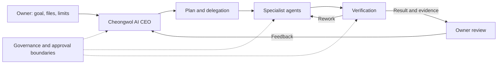

# AX Branch

**An owner-governed workspace for autonomous AI work.**

AX Branch turns a goal and supporting files into a managed workflow. Its AI CEO, **Cheongwol (淸月)**, plans the work, coordinates specialist agents, checks their output, and brings results back to the owner for review. The owner sets the objective and decides on actions that require approval.

> **Project status:** Early-stage, actively developed software. The default `main` branch is version **0.1.59**; newer work is on [`dev/web-ui`](https://github.com/rhkralsrb0820/ax-branch/tree/dev/web-ui). The branches have different capabilities and validation histories. See the development branch and its evidence documents for its current status.

## How it works

1. **Set a goal.** Provide a task and, when needed, supporting files and constraints.
2. **Plan and delegate.** Cheongwol designs a pipeline and assigns steps to specialist agents using the available Claude Code or Codex CLI providers.
3. **Execute and check.** Agents produce artifacts; the engine records work and runs verification. Failed checks can lead to rework or a pause when a decision is needed.
4. **Review.** The owner inspects the result, provides feedback, and decides how to proceed.



Execution state and evidence are recorded so work can be inspected and continued. A separate verification step does not by itself guarantee independent model verification: provider availability can affect which engine performs the check.

## Direction of the project

AX Branch is being developed toward an autonomous agent system with reusable **department harnesses**. A department package describes a role, tools, inputs, outputs, permissions, and acceptance criteria; an agent carries out a particular step within that context. The intended workflow lets an owner attach relevant departments to a project and lets Cheongwol delegate work to them.

The development branch contains work on research, operations, and product-planning departments, a local web interface, and scoped reuse of recorded experience. These are development-branch features, not a claim that the default branch contains the same functionality. Recorded experience is reference material; it does not automatically retrain the model or establish that results improve over time.

## Getting started with `main`

**Requirements**

- Python 3.11 or later.
- A sibling `cheongwol` checkout: AX Branch imports its provider layer from `../cheongwol/ceo`. This repository alone is not a complete installation.
- For live AI work, an installed and signed-in `claude` or `codex` CLI with an appropriate subscription. Viewing the interface is separate from running a live project.

The source layout expected by the application is:

```text
AX-Branch/
├── ax-branch/    # this repository
├── cheongwol/    # required provider layer
├── workspace/    # runtime data when present
└── obsidian/     # knowledge vault when configured
```

From the repository directory:

```sh
# Open the desktop interface
python -X utf8 -m axbranch

# Inspect available CLI commands
python -X utf8 -m axbranch --help

# Check project status
python -X utf8 -m axbranch status
```

The application uses CLI subscriptions rather than a paid API; its existing policy stops execution if a paid API key is present in the environment. Consult [AGENTS.md](AGENTS.md) and the project records before resuming existing work.

## Project records

| Record | Location |
| --- | --- |
| Runtime state | `workspace/axbranch.sqlite3` |
| Versioned artifacts | `workspace/projects/<id>/artifacts/v<N>/` |
| Project handoff | `workspace/projects/<id>/HANDOFF.md` |
| Saved long-term knowledge | `obsidian/AX-Branch-Vault/Branch_DB/Projects/` |

## Testing and evidence

Run the source test suite with:

```sh
python -X utf8 -m unittest discover -s tests -t .
```

Results apply to the exact revision and environment tested. Automated tests, scripted demonstrations, live model runs, packaged-artifact checks, and owner acceptance are different levels of evidence. They should not be treated as interchangeable. Current development-branch evidence and known failures belong to the revision described in its documents, not automatically to `main`.

## Current limitations

- This is not a finished commercial product. Capability and verification coverage vary by branch and execution path.
- OS-level isolation is not a blanket guarantee across all execution paths. Check the relevant branch's security documentation and test evidence before running generated programs.
- Provider availability, usage limits, and environment dependencies can interrupt a workflow or change how it is verified.
- Experience reuse has not been shown to improve output quality through a completed controlled comparison. Automatic self-improvement is a project direction, not an established result.
- Connecting paid services, granting sensitive permissions, contacting external parties, publishing, and spending money require the owner's approval.

## Documentation

- [Architecture](docs/ARCHITECTURE.md) and [decisions](docs/DECISIONS.md)
- [Capability lifecycle and limits](docs/CAPABILITY_LIFECYCLE.md)
- [Changelog](CHANGELOG.md) and [agent instructions](AGENTS.md)
- [Development branch](https://github.com/rhkralsrb0820/ax-branch/tree/dev/web-ui)

No license file is currently provided; reuse permissions have not been specified.
