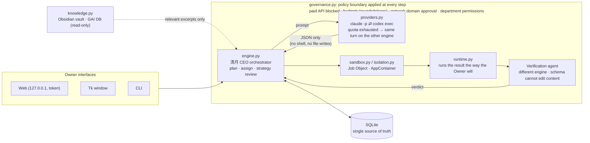
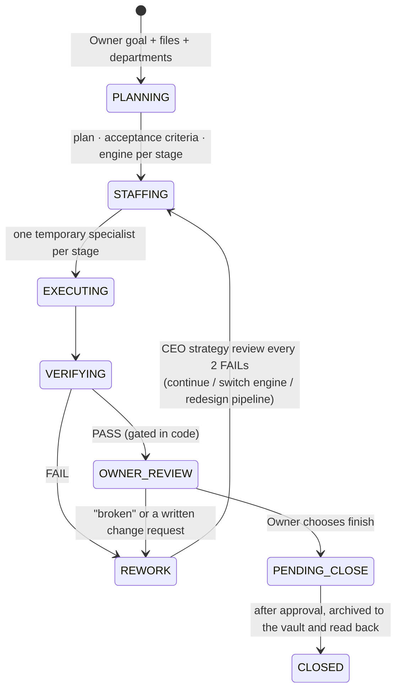
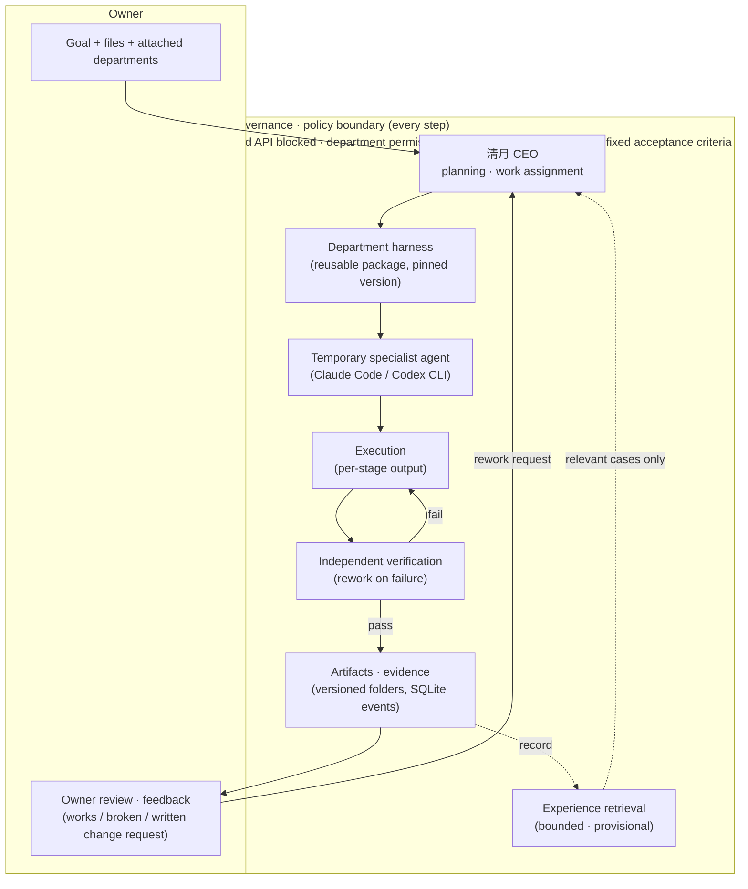
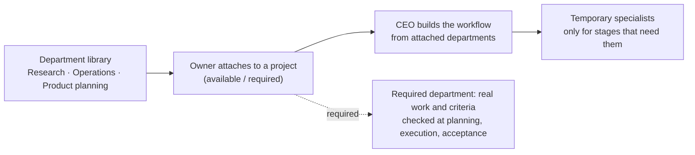
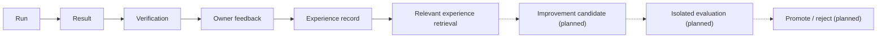

# AX Branch

**Goal-driven autonomous organizational execution under human governance.**

AX Branch is a local workspace where an Owner hands over a goal and AX Branch's AI CEO, **淸月 (Cheongwol)**, does the rest. The CEO plans the work, splits it across the departments the Owner attached, and runs temporary specialist agents on the Owner's Claude Code / Codex CLI subscriptions. Each result is checked by a separate verification step and reworked until it passes. Only then does it reach the Owner for review. The Owner sets the goal and the limits; AX Branch handles the AI work inside them.

> Status: a personal project under active development. Current source is **0.1.67** (`dev/web-ui`): full regression 591 tests = 590 passed, 1 skipped (reason recorded), 0 failed (commit `a76dfbc`). Python 3.11+, standard library only.

**1-minute tour:** [Architecture](#architecture) → [Orchestration](#orchestration) → [Evaluation](#evaluation) → [Failure reproduction and fixes](#failure-reproduction-and-fixes)

## Architecture



- **Agents have no shell and no file-write access.** They return JSON; the engine writes the files. Execution happens in isolated processes (Job Object, AppContainer).
- **SQLite is the source of truth.** Every step commits before the next one. If the engine stops, `python -m axbranch run <id>` resumes, and either engine (Claude or Codex) can pick it up.
- **Engines are interchangeable.** An agent is defined by role, goal, context, permissions and tools; the provider is just the engine that runs one turn.

## Orchestration



| Mechanism | Behavior |
|---|---|
| Resume | `run()` recomputes the next step from SQLite every time. An OS file lock allows one session per project. |
| Engine failover | A quota refusal moves the same turn to the other engine; the next turn tries the preferred engine again. |
| Pause | Budget exhausted, both quotas exhausted, missing tool or unapproved network → PAUSED with `resume_state` remembered. Only the Owner resumes. |
| Owner feedback | First reproduce the delivered version, then check that the revised acceptance criteria **fail on the old version**. Only then rebuild and re-verify. |
| Transactions | The REWORK transition, the strategy-review obligation and any budget stop commit in one transaction. |

## Evaluation

**PASS is decided by code, not by the model.** All five conditions must hold:

1. The verification model's verdict is PASS
2. **Every** acceptance criterion is met
3. Zero critical/major findings
4. Deterministic checks pass (e.g. the generated program's `--self-test`)
5. Runtime Acceptance passes: the result is launched exactly as the Owner launches it (cli/web/gui) and its primary flow is exercised

| Layer | Method |
|---|---|
| Independent verification | A different prompt from the producer, and an output schema with no content field, so the verifier cannot fix the result itself. Runs on the other engine when possible; which one actually ran is recorded (other engine / same engine with role separation / unknown). |
| Source verification | Every claim is checked against the fetched source and a verbatim quote. On re-verification a previous judgment is reused only if the source is byte-identical. |
| Failure attribution | Every FAIL gets an `attribution_trace` that separates **harness defects** from **product defects**. Harness defects do not spend the product budget. |
| Training effect (`model_compare.py`) | Hashes of model files, evaluation inputs and answers are fixed; train/eval overlap is checked; only the evaluator holds the answers. Scores (accuracy, macro-F1) are computed by AX Branch's own code, and an effect is claimed only "in this evaluation". |
| Regression | 591 tests with stdlib `unittest`, including a real AppContainer and a headless browser. `test_release.py` fails if the version and CHANGELOG disagree. |

**Negative results are recorded as they are.**
- In the demo, LoRA was actually trained but scored 0.9159, below the baseline (0.9669). Recorded as `lora_not_better`.
- The experience-reuse A/B experiment stopped without a result both times (64,487 tokens, over the 60,000 limit). The effect stays unverified.

## Failure reproduction and fixes

Sources: the Fixed entries in the [CHANGELOG](CHANGELOG.md) and [`docs/evidence/`](docs/evidence/).

| Version | Symptom | Root cause | Fix | Guard |
|---|---|---|---|---|
| 0.1.34 | A correct product failed 4 times on "status 201, expected -1" and was rebuilt until the budget was EXHAUSTED | A test-probe error was judged a product defect. The CEO repaired the probe correctly, but a later step (T5) undid that repair | Harness and product defects are separated. T5 keeps exact status codes and assertions | Outcome attribution v1, full suite 284/284 |
| 0.1.39 | A crash during strategy review could apply a plan change twice | The plan change and its completion marker were committed separately | Both commit in one transaction | Regression test |
| 0.1.50 | Goal 1 alone made 16 verifier calls | Every re-verification re-sent the full report and evidence | `verification_basis` hash; a claim is reused only if its source is byte-identical and its quote is still verbatim | `test_sources` 35/35 (changed / unreadable source or missing quote can never PASS) |
| 0.1.51 | Real training-stack setup failed (pip could not write a torch header) | Windows' 260-character path limit under a deep project folder | Use a short path. The admin setting (long paths) was left untouched | Re-run succeeded (273 s) |
| 0.1.67 | 1 of 591 full-regression tests failed (`test_open_use_isolate_and_stop`) | `rmtree(ignore_errors)` ran once while Windows still held the killed process's handles, leaving a run folder with isolation grants | Removal retries briefly at every cleanup point | Full re-run on `a76dfbc`: 590 passed, 1 skipped, 0 failed |
| Open | Browser runtime tests intermittently exceed the 90 s limit | **Root cause not identified.** Isolated reproduction failed 2/10 on this branch and 1/10 on `main`; the relevant code is identical on both | A longer limit or a retry would hide the failure, so **neither was added on purpose** | [Reproduction record](docs/evidence/2026-10-24-F160b-runtime-failure.md) |


## What it solves

When you hand work to AI tools, a person still ends up splitting the plan, picking tools, checking results and asking again. AX Branch takes over that management work. The Owner provides a goal and materials and only judges whether the result is actually usable.

**Example flow**

1. The Owner writes a goal in the web UI, e.g. "Build a per-team inquiry-count report from the attached inquiry log", attaches a CSV, and drags **Research** and **Operations** in from the department library.
2. The 淸月 CEO plans: the research stage compiles figures and evidence, the operations stage writes recommendations. Each stage gets a temporary agent with that department's role, tools, permissions and acceptance criteria.
3. The output goes through a separate verification step. If any department acceptance criterion (e.g. "every figure has a source") is not met, it goes back to rework.
4. Only passing results reach Owner review. A written request such as "change the title" is reworked and re-verified **in the same project**, and the revised version comes back.
5. Recorded runs and verification results are retrieved, with bounded scope, as reference material in later work. This is "experience reuse", not training.

## Detailed structure

### Overall flow

Governance and policy are not a final step but a **permission boundary** around everything from planning to delivery.



### Departments



### Experience lifecycle

Solid lines are implemented; dotted lines are planned.



### Terms

| Distinction | Meaning |
|---|---|
| **Harness ≠ agent** | A department harness (`departments/<id>/department.json`) is a **reusable package** of role, tools, permissions, inputs/outputs and acceptance criteria. An agent is a **temporary executor** built from a harness for one stage and then discarded. |
| **Capability ≠ permission** | What an agent can do differs from what it may do. If a department does not declare network permission, a web-research stage is refused at planning. Agents never get a shell. |
| **Stored experience ≠ training** | Experience is recorded in the existing SQLite event store and retrieved as reference material later. Model weights do not change (no fine-tuning). |
| **Retrieved experience ≠ verified improvement** | Retrieved experience is labelled PROVISIONAL. Whether it actually improves results has not been measured yet (see limits below). |

### Departments in the library

There are three: **Research** (1.1.0), **Operations** (1.1.0) and **Product planning** (1.0.1). A department is pinned to its version when attached, so later definition changes never leak silently into running projects. Each department has a registry state (candidate · verified · quarantined · retired). Quarantined or retired departments cannot be newly attached or given work, but pinned records stay. The three current departments predate states and are marked legacy: their spec format is validated, their behavior is not yet judged. Finance, legal or marketing departments could be added in the same format; they are **future examples** and do not exist today.

## Implementation status

| Feature | Status | Verification level |
|---|---|---|
| Goal · files · departments → CEO plan → staged execution | Implemented | Automated tests · real model runs |
| 3 department harnesses, version pinning, permission check at planning | Implemented | Automated tests · real model runs |
| Independent verification and rework loop (criteria never lowered) | Implemented | Automated tests · real model runs |
| Owner written change request → rework and re-verification in the same project | Implemented | Real packaged web E2E 11/11 (candidate build 0.1.63-18fbd6d, P-20261027-f8b412) |
| Verification provenance (other engine / same engine, role-separated / unknown) | Implemented | Automated tests |
| Bounded experience retrieval (provisional label) | Implemented | Automated tests |
| Result library; continuing development of a finished result | Implemented | Automated tests |
| Local web UI · Tk window · CLI (shared behavior) | Implemented | Automated tests · headless browser |
| Owner devroom (AX Branch's own development status) | Implemented | Automated tests |
| Experience-reuse effect comparison (product planning A/B) | **No result** | Both attempts stopped at task A (not retried) |
| H1: department registry states, evidence and history, quarantine enforcement | Implemented | Automated tests (no real model run) |
| H2: "available / required" departments, enforced at planning · execution · acceptance · detachment | Implemented | Automated tests · headless browser · 1 real model run (satisfied path only, [evidence](docs/evidence/2026-10-26-h2-required-real-run.md)) |
| Product-planning contract (required headings · JSON) passed identically to planning, production and verification; pre-flight conflict check | Implemented | Automated tests |


## Verification levels and limits

**Verification levels**

- **Automated tests**: full regression 591 = 590 passed + 1 skipped (reason recorded) + 0 failed (commit a76dfbc).
- **Real model runs**: runs that called real subscription models. Evidence in [`docs/evidence/`](docs/evidence/).
- **Build candidate**: checked with a preserved package.
- **Unverified**: not checked by any of the above.

**Known limits**

- **OS isolation has a limited scope.** The current source uses AppContainer to protect generated-program checks and in-app restricted CLI / single-process result runs; blocking was confirmed with real decoy files and tokens. Web/server, training interpreters and protected GUI result runs are unsupported and therefore blocked; explicit Owner-exception runs and external manual runs are outside this protection. It does not claim to block every allowed system read. Not yet applied to the older running server.
- **No automatic self-improvement.** Experience is recorded and referenced only; candidate generation, isolated evaluation and promotion are planned.
- **Cross-engine verification is not always guaranteed.** Independent verification should run on a different engine (Codex) from production, but usage limits forced some runs to verify on the same engine; each run records which.
- **The experience-reuse A/B comparison has no result.** A reduced experiment was attempted twice and stopped at task A both times.
  - First attempt: the task wording did not match the department contract ([evidence](docs/evidence/2026-10-26-product-ab-compact-run.md)).
  - Second attempt (contract aligned): the first draft's `excluded`/`experiments` lists were empty, causing rework, and the run exceeded the 60,000-token per-project limit (64,487 tokens, [evidence](docs/evidence/2026-10-27-codex-163.md)).
  - The effect is unverified; improvement candidates are in the [improvement backlog](docs/IMPROVEMENT_BACKLOG.md).
- **Web E2E scope for written-change rework.** Passed once with real models on candidate build 0.1.63-18fbd6d (11/11).
  - Codex and Claude alternated as verifier; the actual provider is recorded.
  - The test feedback was delegated test input, not a real Owner confirmation.
- **Intermittent test issues.** The browser self-test occasionally does not finish within 90 s; root cause unknown. One full run had 4 time-sensitive test failures that did not recur; cause also unknown.
- No claim of commercial-product quality.

## Running it (local web)

**Requirements**

- Python 3.11+ (checked on 3.12.10).
- The `cheongwol` repository must sit next to this one; its provider layer is reused.
- To actually run work, the `claude` or `codex` CLI must be logged in with a subscription account. Opening the UI alone never calls a model.
- No paid API is used. If a paid API key is present in the environment, runs stop.

```text
AX-Branch/
├── ax-branch/     ← this repository
├── cheongwol/     ← required (cheongwol/ceo is imported)
├── workspace/     ← runtime data goes here if present
└── obsidian/      ← used as the work root together with workspace/
```

```sh
cd ax-branch
python -X utf8 -m axbranch web              # http://127.0.0.1:8765/ (open the browser yourself)
python -X utf8 -m axbranch web --port 8799  # another port
python -X utf8 -m axbranch web --stop       # stop the running web server
```

- The server listens on `127.0.0.1` only. The UI's API answers only with the token issued at startup.
- If the parent folder has **neither** `workspace/` nor `obsidian/`, the in-repo `workspace/` is used.
- The commands above were checked in an isolated copy: server start → page response (200) → `--stop`.
- The desktop window opens with `python -X utf8 -m axbranch`. In the packaged build: `AXBranch.exe`, and `AXBranch.exe web` for the web UI.
- Other CLI commands (new / run / status / review / finish, etc.): `python -m axbranch --help`.

Tests and build:

```sh
python -X utf8 -m unittest discover -s tests -t .
python -X utf8 build_exe.py
```

## Where results and evidence live

| What | Where |
|---|---|
| Runtime state (source of truth) | `workspace/axbranch.sqlite3` |
| Artifacts (per version) | `workspace/projects/<id>/artifacts/v<N>/` |
| Engine-to-engine handoff | `workspace/projects/<id>/HANDOFF.md` |
| Long-term knowledge (on save & close only) | `obsidian/AX-Branch-Vault/Branch_DB/Projects/` |
| Development evidence (experiments · E2E · audits) | [`docs/evidence/`](docs/evidence/) |
| Owner devroom data | [`docs/devroom/status.json`](docs/devroom/status.json), shown in the web UI's Owner devroom |
| Development handoff (Claude Code ↔ Codex) | [`docs/CODEX_CLI_HANDOFF.md`](docs/CODEX_CLI_HANDOFF.md) |

## Roadmap

- **H1 — Department registry states (implemented).** Each department carries a candidate · verified · quarantined · retired state with reason, evidence and history. Only the Owner changes a state, with a record (`python -m axbranch lifecycle`); promotion to "verified" needs at least two pieces of evidence.
- **H2 — Available / required departments (implemented).** A required department is enforced to have actually worked and met its criteria at each point:
  - planning;
  - execution and rework;
  - result acceptance;
  - detachment.
- **Next.**
  - Confirm with a real model that a plan missing a required department is blocked (currently automated tests only).
  - The product-planning A/B stopped twice; retrying needs a new Owner decision. Review backlog items IB-1 and IB-2 first.
  - The improvement-candidate, isolated-evaluation and promotion stages of the experience lifecycle are planned.

**H3 department recommendations are also implemented.** Within the CEO's existing planning call, up to three departments are suggested with reasons; they are attached only when the Owner accepts. A recommendation alone never changes execution, permissions or required conditions, and never restarts the current plan. Checked with a mock model, real HTTP and headless Chrome; real-model recommendation quality is not yet verified.

Design: [Department Harness Proposal](docs/DEPARTMENT_HARNESS_PROPOSAL.md). H4, further model training and paid services are out of scope.

## Versions: current source and serving build

| | Version | Notes |
|---|---|---|
| This branch's source | 0.1.67 (`dev/web-ui`, default branch) | Full regression 591 = 590 passed + 1 skipped (a76dfbc). Candidate build 0.1.67-a76dfbc |
| Server the Owner uses | An earlier build | See `serving_build` in the [Owner devroom](docs/devroom/status.json) |
| `main` branch | 0.1.59 snapshot | Older; not the default branch |

## Documents

- [Docs guide](docs/README.md): user vs. developer documents
- [Architecture](docs/ARCHITECTURE.md) · [Decisions](docs/DECISIONS.md) · [Changelog](CHANGELOG.md)
- Agent working rules: [AGENTS.md](AGENTS.md)

No license file yet (all rights reserved).
